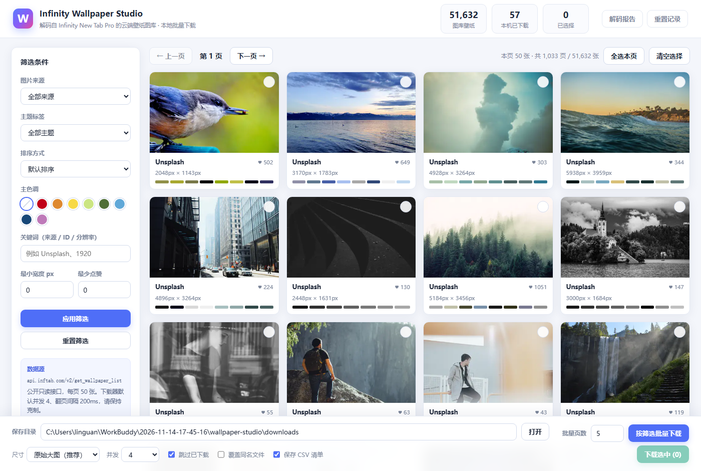

# Infinity Wallpaper Studio

从 **Infinity New Tab Pro** 浏览器插件（v11.0.41）中解码出其壁纸图库的公开接口，并基于该接口实现的**批量壁纸下载工具**。

- 图库规模：**51,632 张**壁纸、1,033 页
- 无需登录、无需 Cookie、无需签名
- 提供 Windows 安装包、免安装绿色版、源码运行三种方式

> 下载地址：**[Releases v1.0.0](https://github.com/wangsansui963/infinity-wallpaper-studio/releases/tag/v1.0.0)**（安装包 10.2 MB / 绿色版 10.2 MB）



## 功能

- **浏览**：来源 / 主题 / 主色 / 排序 / 关键词 / 最小宽度 / 最少点赞多维筛选，网格缩略图分页浏览
- **下载**：单独下载选中项，或按当前筛选「连续抓 N 页」批量下载
- **图片尺寸**：原图，或实时生成 1280 / 1920 / 2560 / 3840 px 的 WebP 缩放图
- **去重**：SQLite 记录已下载项，支持跳过已下载 / 覆盖同名文件
- **清单**：自动追加写入 `wallpapers.csv`（id、来源、点赞、尺寸、原图直链）
- **进度**：实时进度、任务日志、随时取消；并发 1–8 可调（默认 4，翻页有间隔，避免压垮接口）
- **解码报告**：软件内「解码报告」面板直接展示 13 条编号证据的完整取证链

## 使用

### 方式一：安装包（推荐）

1. 到 [Releases](https://github.com/wangsansui963/infinity-wallpaper-studio/releases/latest) 下载 `InfinityWallpaperStudio-Setup-*.exe`
2. 双击按向导安装（简体中文，无需管理员权限）
3. 桌面 / 开始菜单启动，浏览器自动打开界面

安装位置 `%LOCALAPPDATA%\Programs\Infinity Wallpaper Studio`，壁纸默认存到 **图片\Infinity Wallpapers**。卸载不会删除已下载的壁纸。

### 方式二：免安装绿色版

从 [Releases](https://github.com/wangsansui963/infinity-wallpaper-studio/releases/latest) 下载 `Infinity-Wallpaper-Studio-portable.exe`，放到任意目录双击运行。程序不依赖本机 Python。

### 方式三：源码运行

需要 Python 3.9+，无第三方依赖：

```bash
python app.py                  # 启动本地界面并自动打开浏览器
python app.py --no-browser     # 只启动服务
python app.py --port 9000      # 指定端口（默认 8765，被占用时自动顺延）
```

Windows 上也可直接双击 `start.bat`，脚本会自动定位可用的 Python 解释器（会跳过 Microsoft Store 的假存根）。

## 命令行批量下载

```bash
python app.py --cli --pages 5 --source Unsplash --tag nature --out D:\Wallpapers
```

| 参数 | 说明 | 默认 |
| --- | --- | --- |
| `--cli` | 启用命令行模式 | — |
| `--pages N` | 连续抓取页数（每页 50 张） | 1 |
| `--start-page N` | 起始页（1 基） | 1 |
| `--source NAME` | 图源，留空为全部 | 全部 |
| `--tag NAME` | 主题标签 | 全部 |
| `--color HEX` | 主色，如 `60a8d8`（不带 #） | 全部 |
| `--order like\|_id` | 按点赞 / 按收录排序 | 默认 |
| `--q 关键词` | 关键词搜索 | — |
| `--min-width PX` | 最小宽度过滤 | 0 |
| `--min-likes N` | 最少点赞过滤 | 0 |
| `--width PX` | 缩放宽度；`0` 表示下载原图 | 0 |
| `--concurrency N` | 并发下载数（1–8） | 4 |
| `--limit N` | 最多下载 N 张 | 不限 |
| `--out DIR` | 保存目录 | `./downloads` |
| `--dry-run` | 只打印将下载的清单，不落盘 | — |

## 解码结果

目标包 `infinity-new-tab-pro@latest.zip` 内是 **CRX3**（magic `Cr24`、version 3、头长 1309 字节）。剥掉 `12 + 1309` 字节头得到标准 ZIP，共 392 个文件，在 `newtab/newtab.js` 与数字 chunk 中定位到壁纸模块。

### 列表接口

```
GET https://api.inftab.com/v2/get_wallpaper_list?client=pc&page=<0 基>&source=&tag=&color=&order=
```

- 无需任何凭证；参数白名单只有 `client, page, source, tag, color, order`，多传 `limit/size/count` 会被拒绝（`code 2001 is not allowed`）
- 每页固定 50 条，累计 51,632 张 / 1,033 页
- 返回字段：`code, message, data.count, data.totalPages, data.nextPage, data.list[].{_id, imgId, source, like, dimensions, colors, src.rawSrc}`

**来源（14）**：`InfinityLandscape`、`Infinity`、`bing`、`Unsplash`、`Life Of Pix`、`MMT`、`Realistic Shots`、`Jay Mantri`、`Free Nature Stock`、`Skitter Photo`、`Startup Stock Photos`、`Barn Images`、`Picography`

**主题（10）**：`nature`、`ocean`、`architecture`、`animals`、`travel`、`food-drink`、`anime`、`athletics`、`technology`、`street-photography`

**主色（8）**：`c00018`、`de8930`、`f7d946`、`cbe582`、`506f37`、`60a8d8`、`184878`、`be7ab9`

### 图片地址

- 原图：`src.rawSrc` 直接匿名可下
- 缩放 / 缩略图：`src.rawSrc + ?imageView2/2/w/<宽度>/format/webp/interlace/1`（七牛 imageView2，服务端实时生成）

### 未使用的接口

`/get-wallpaper`、`/v2/random-wallpaper`、`/v2/get_bing_wallpaper`、`/v2/get_next_wallpaper`；以及需登录的 `/v2/like_wallpaper`、`/v2/collection_wallpaper`、`/v2/get_user_wallpaper_library*`。下载器只依赖公开只读的列表接口。

完整的 13 条编号证据（观察 / 推导 / 推断分层）见 [`analysis/findings.json`](analysis/findings.json)，也可在软件内「解码报告」查看。

## 目录结构

```
app.py                  后端 + CLI（纯标准库，单文件）
index.html              界面骨架
static/app.js           前端逻辑
static/style.css        样式
analysis/findings.json  解码证据链
assets/app.ico          应用图标
installer.nsi           NSIS 安装脚本
start.bat               Windows 源码启动脚本
docs/screenshot.png     README 截图
```

## 自己打包

```bash
# 1. 独立 exe（PyInstaller 单文件）
pip install pyinstaller
P=$(pwd)
python -m PyInstaller --noconfirm --clean --onefile --windowed \
  --icon "$P/assets/app.ico" --name "Infinity Wallpaper Studio" \
  --add-data "$P/index.html;." --add-data "$P/static;static" \
  --add-data "$P/analysis/findings.json;analysis" \
  --distpath dist --workpath build --specpath build app.py

# 2. 安装程序（NSIS 3.10+）
makensis installer.nsi
```

产物在 `dist/`。

## 技术说明

- 后端只用 Python 标准库（`http.server` + `urllib` + `sqlite3`），无第三方运行时依赖
- 冻结运行时资源从 `sys._MEIPASS` 读取，用户数据写到 `%LOCALAPPDATA%\Infinity Wallpaper Studio`
- 启动前会扫描 8765–8776，已有实例时直接复用并打开页面，不会开第二个服务
- 下载走线程池，临时文件 `.part` 落盘后原子重命名，中断不留半张图

## 免责声明

本项目仅用于**个人学习与个人备份**。接口属于该插件的私有用途，其速率限制与长期可用性不在本项目控制范围内，请勿高频抓取。各图源（Unsplash、Bing 等）的授权条款以各自官网为准，下载内容请勿用于商业用途或二次分发。若权利人提出异议，请停止使用并删除相关内容。
